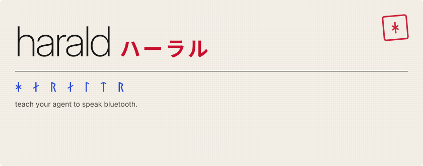

<p align="center">
  
</p>

<p align="center">
  <a href="https://pypi.org/project/harald/"></a>
  <a href="#四-agent-setup"></a>
  <a href="#三-devices"></a>
  <a href="LICENSE"></a>
</p>

<p align="center">
  <a href="#二-install">install</a> &nbsp;/&nbsp;
  <a href="#一-how-it-works">how it works</a> &nbsp;/&nbsp;
  <a href="#三-devices">devices</a> &nbsp;/&nbsp;
  <a href="#六-contributing-a-device">add your device</a>
</p>


**fig. 1** · claude + harald take an istrip+ strip from unknown to pink in one session.

## 一 how it works

harald is an mcp server, a cli and a playbook for coding agents. it gives your agent
hands and ears for bluetooth le, so it can work out the protocol of a gadget you own.
then you control that gadget from your own code instead of the vendor's app.

| *listen* | *decode* | *speak* |
| :--- | :--- | :--- |
| harald reads what the vendor app says to the gadget, from your phone's bluetooth log. | your agent works out the language, keys and checksums included, by diffing payloads, testing keys and searching the vendor's android app. | you get the protocol written up and a standalone driver script with its own small cli. no vendor app. |

## 二 install

you need [uv](https://docs.astral.sh/uv/). then:

```sh
uvx harald --help
```

that is the whole install: uvx fetches harald and runs it. every `harald ...` command
below works the same as `uvx harald ...`, or run `uv tool install harald` once to keep
`harald` on your path. tested on mac.

the first time harald scans, macos asks whether your terminal app may use bluetooth.
allow it. if you missed the prompt, turn it on in system settings › privacy & security
› bluetooth.

two optional tools, for the steps that need them:

- `brew install jadx` lets harald read a vendor's android app.
- `brew install libimobiledevice` records your iphone's bluetooth log from the terminal.

harald also works without an agent:

```text
harald scan                          list bluetooth le devices nearby
harald connect <address>             list a device's services and characteristics
harald read <address> <char>         read a characteristic once
harald write <address> <char> <hex>  write bytes, once you have armed the device
harald capture open <file>           show a phone capture as a timeline
harald apk <file>                    search a vendor android app for uuids and keys
harald devices                       list the device library
harald drive <slug> <command>        run a library device's driver
```

`harald --help` lists the rest.

## 三 devices

| device | what harald found | status |
| :--- | :--- | :--- |
| istrip+ led strip | being worked out on real hardware | in progress |
| your device | open a pull request with its protocol file | wanted |

each decoded device lives in [`devices/`](devices/) with its protocol written up and a
standalone driver. `harald devices` lists them, and `harald drive <slug> <command>`
runs one, for example `harald drive <slug> on`.

## 四 agent setup

add the mcp server to your agent, then install the playbook: the step-by-step method
your agent follows to crack a gadget.

**claude code**, in your project folder:

```sh
claude mcp add harald -- uvx harald mcp
harald playbook install claude-code --dest .claude/skills/harald
```

use `--dest ~/.claude/skills/harald` to have the skill in every project.

**codex**

add this to `~/.codex/config.toml`, or run `codex mcp add harald -- uvx harald mcp`:

```toml
[mcp_servers.harald]
command = "uvx"
args = ["harald", "mcp"]
```

then, in your project folder:

```sh
harald playbook install codex
```

this writes `AGENTS.md`. if your project already has one, harald leaves it alone; use
`--dest ~/.codex` to install it for every project instead.

**cursor**

add this to `.cursor/mcp.json` in your project, or to `~/.cursor/mcp.json` for every
project:

```json
{
  "mcpServers": {
    "harald": {
      "command": "uvx",
      "args": ["harald", "mcp"]
    }
  }
}
```

cursor has no playbook; it uses harald's tools directly.

then ask your agent to work out your gadget with harald. it will ask you for two things
only you can do.

**record your phone talking to the gadget.** a computer cannot overhear phone-to-gadget
traffic without extra hardware, so the log comes from your own iphone.

1. on the iphone, install apple's bluetooth logging profile: "bluetooth for ios/ipados"
   on apple's [profiles and logs](https://developer.apple.com/bug-reporting/profiles-and-logs/?name=bluetooth)
   page. it is free.
2. connect the iphone to your mac by cable. open packetlogger, from apple's
   [additional tools for xcode](https://developer.apple.com/download/all/), and choose
   file › new ios trace. or, from the terminal: `idevicebtlogger capture.pklg`, which
   records until you press ctrl-c.
3. in the vendor app, do one thing at a time, a few seconds apart, in the order your
   agent asks for.
4. stop the trace, save the `.pklg` file and give your agent its path. to look at it
   yourself: `harald capture open capture.pklg`.

if packetlogger records nothing, remove the logging profile and install it again.

**get the vendor's android app.** if the commands look encrypted, your agent asks for
the apk of the vendor app you already use. you don't need an android phone, and
harald never downloads apps: download it yourself from
[apkmirror](https://www.apkmirror.com/), which verifies each app's signature, or with
[apkeep](https://github.com/EFForg/apkeep) (`apkeep -a <package name> .`). the package
name is the `id=` part of the app's play store address.

## 五 safety

harald is for gadgets you own: interoperability and research. don't use it on anyone
else's devices.

- **writes need you.** harald refuses every write until you run, in your own terminal:

  ```sh
  harald arm <address> --writes n --minutes m
  ```

  that grants a budget of n writes for m minutes (50 and 30 if you leave the flags
  out), and each write spends one. it shows the grant and waits for you to type
  `arm`, and it refuses to run outside a terminal, so it can't be piped through.
  `harald status` shows what is armed and `harald disarm <address>` revokes it. there
  is no mcp tool that arms, so your agent can never approve its own writes. one gap
  remains: grants live in a file, `~/.harald/arm.json`, and an agent that can write
  files could edit it. if yours can write outside your project, keep that in mind.
- **firmware updates are blocked.** writes to firmware-update (dfu) services stay
  refused even when a device is armed, so a stray write cannot start a firmware update.
  only `--allow-dfu` on `harald arm` lifts that, and working out a protocol never
  needs it.
- **only app-wide keys are shared.** a `devices/` entry may carry a key only if it is
  the same on every unit and ships inside the vendor app. per-unit keys and pairing
  keys never go in the library; they stay in your own `harald-work/` folder.

## 六 contributing a device

cracked a gadget? your agent's work is in `harald-work/<slug>/`. turn it into
`devices/<slug>/` with a `device.toml`, `protocol.md` and `driver.py`, then open a pull
request. the [contributing guide](CONTRIBUTING.md) has the details, including the keys
rule.

<sub>mit license. harald is named after king harald "bluetooth" of denmark, after whom
bluetooth is named; ᚼᛅᚱᛅᛚᛏᚱ is his name as it is carved on the jelling stone.</sub>
